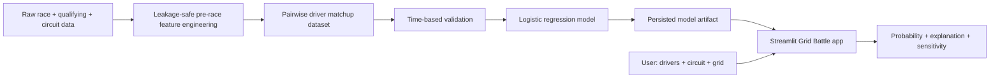

# 🏎️ Grid Battle — Formula One Simulator

> **Two drivers. One circuit. Your starting grid.**

Grid Battle is an interactive Formula One fan-engagement microproduct that predicts the probability that one driver finishes ahead of another under a user-selected circuit and starting-grid scenario.

The larger Formula One Simulator vision is a full race-scenario engine. Grid Battle is the first deployable slice: small enough to ship, rich enough to demonstrate the product idea, and structured so weather, tyres, telemetry, reliability, and full-grid simulation can be added later.

---

## ✨ What the product does

Pick:

- **Driver A**
- **Driver B**
- **Circuit**
- **Starting position for each driver**

Grid Battle returns:

- the probability that each driver finishes ahead
- the model favourite
- an explanation of the strongest model influences
- a side-by-side driver/team comparison
- observed 2024 head-to-head results in the supplied dataset
- a grid-position sensitivity curve
- an **Equal-grid mode** for controlled what-if comparisons

Example question:

> **If Lewis Hamilton and George Russell started P3 and P5 at Silverstone, who would the model favour? What changes if Hamilton starts P10 instead?**

---

## 🎯 Why this exists

Formula One broadcasts expose fans to enormous amounts of data, but most prediction experiences are passive: a model or pundit tells the viewer who is likely to win.

Grid Battle makes prediction interactive.

Instead of only asking:

> **Who is better?**

fans can explore:

> **Under these conditions, who has the edge — and why?**

The long-term goal is to turn race prediction into a sandbox where users can manipulate relevant conditions and immediately see how the expected outcome changes.

---

## 🧠 Modeling approach

The current V1 treats the matchup as a **pairwise classification problem**:

```text
Driver A finishes ahead → 1
Driver B finishes ahead → 0
```

Every 20-driver race contains 190 unordered driver pairs. Representing each pair in both orientations creates thousands of head-to-head training examples from the supplied season while preserving the underlying race as the evaluation boundary.

### Leakage-safe feature pipeline

For every driver/race, the project calculates statistics using **only races that occurred before that race**.

Current feature families include:

- starting-grid difference
- driver recent finishing form
- driver qualifying form
- average points
- positions gained/lost tendency
- DNF rate
- top-5 consistency
- constructor finishing and qualifying form
- constructor points and reliability proxies
- driver/constructor performance by circuit type
- season experience
- grid interactions with circuit context

Team features are aggregated at the **team/race level before shifting**, preventing one teammate's current result from leaking into the other teammate's feature row.

### Model

The deployed V1 uses:

```text
StandardScaler → LogisticRegression
```

This was chosen because it is lightweight, fast, probabilistic, symmetric for pairwise comparisons, and easy to explain.

### Validation

The model is not evaluated with a random row split. Instead, the **latest five races are held out chronologically**.

Current time-holdout performance on the supplied dataset:

| Metric | Result |
|---|---:|
| Accuracy | **86.9%** |
| ROC AUC | **0.962** |
| Brier score | **0.075** |
| Holdout races | **5** |
| Holdout matchup rows | **1,900** |

After evaluation, the deployment artifact is refit on all available supplied races.

See [`docs/MODEL_CARD.md`](docs/MODEL_CARD.md) for details and limitations.

---

## 🖥️ Product experience

The Streamlit app includes four analysis views:

### 1. Why this result
Shows the largest model contributions. Positive influence favours Driver A; negative influence favours Driver B.

### 2. Driver comparison
Shows team, starting grid, average finish, qualifying form, points, positions gained, top-5 rate, DNF rate, and circuit-type form.

### 3. Grid sensitivity
Holds Driver B fixed and moves Driver A from P1–P20 to show how starting position changes the head-to-head probability.

### 4. Model & limitations
Displays validation metrics and makes clear which factors are — and are not — currently learned from data.

---

## 📊 Data

The repository contains the supplied Kaggle Formula One snapshot under `data/raw/`.

Current files:

```text
data/raw/
├── f1_2024_race_results.csv
├── f1_qualifying_results_2024.csv
├── f1_2024_driver_standings.csv
├── f1_2024_constructor_standings.csv
├── f1_circuits_metadata.csv
├── f1_historical_drivers.csv
└── dataset-metadata.json
```

The initial exploratory analysis is available in:

```text
notebooks/01_initial_eda.ipynb
```

### Important data note

Grid Battle is currently a Datathon prototype trained on the repository's Kaggle snapshot. The data should be validated/replaced with authoritative historical timing data before making real-world performance claims. The app therefore presents its output as an exploratory fan simulation rather than an official F1 forecast or betting product.

---

## 🏗️ Architecture



The deployed application does **not** train a model for each user. The model is pre-trained and loaded once per application process using Streamlit caching, keeping interactive inference lightweight.

---

## 📁 Repository structure

```text
FormulaOneSimulator/
├── app/
│   └── app.py
├── artifacts/
│   ├── model_metadata.json
│   └── pairwise_model.joblib
├── data/
│   ├── raw/
│   └── processed/
├── docs/
│   ├── DEPLOYMENT.md
│   ├── MODEL_CARD.md
│   └── project_scope.md
├── notebooks/
│   └── 01_initial_eda.ipynb
├── src/
│   ├── f1_predictor/
│   │   ├── __init__.py
│   │   ├── features.py
│   │   ├── model.py
│   │   ├── preprocessing.py
│   │   └── train.py
│   └── formulaonesimulator/
│       └── __init__.py
├── tests/
│   └── test_pipeline.py
├── .streamlit/
│   └── config.toml
├── Dockerfile
├── Makefile
├── requirements.txt
├── pyproject.toml
└── README.md
```

---

## 🚀 Run locally with `uv`

### 1. Clone the repository

```bash
git clone <YOUR-REPOSITORY-URL>
cd FormulaOneSimulator
```

### 2. Create/sync the environment

```bash
uv sync
```

`uv` will create a fresh `uv.lock` for your environment the first time if one is not already present. Commit that lock file once generated so your team shares the same resolved environment.

### 3. Launch the app

The repository already includes a trained model artifact, so normally you can immediately run:

```bash
uv run streamlit run app/app.py
```

Open:

```text
http://localhost:8501
```

### 4. Retrain after changing data/features

```bash
uv run python -m f1_predictor.train
```

or:

```bash
make train
```

### 5. Run tests

```bash
uv run pytest
```

---

## 🐳 Docker deployment

Build:

```bash
docker build -t grid-battle .
```

Run:

```bash
docker run --rm -p 8501:8501 grid-battle
```

Open `http://localhost:8501`.

See [`docs/DEPLOYMENT.md`](docs/DEPLOYMENT.md) for deployment and scaling notes.

---

## ⚡ Why this can handle a small–medium demo workload

V1 is intentionally operationally simple:

- no external API calls during user interaction
- no database requirement
- no model training per request
- small in-memory source tables
- one lightweight logistic-regression inference per scenario
- cached model and feature context
- stateless user sessions apart from Streamlit UI state
- container-ready health check

For materially larger production traffic, the natural evolution is to expose inference through a stateless FastAPI service and scale multiple app/API replicas behind a load balancer.

---

## 🧪 Current limitations

The model intentionally does **not** pretend to use data that is not present yet.

V1 does not currently learn from:

- live weather
- track temperature
- tyre compounds
- pit-stop strategy
- safety-car probability
- lap-by-lap telemetry
- fuel/load effects
- engine-mode or component-health telemetry

These are roadmap features rather than hard-coded or fabricated inputs.

---

## 🗺️ Roadmap

### V1 — Grid Battle ✅
- driver vs driver
- circuit selection
- starting-grid what-if controls
- probability of finishing ahead
- explainable feature contributions
- sensitivity analysis

### V1.5 — Data enrichment
- authoritative timing results
- lap and sector features
- weather
- tyre data
- pit stops
- telemetry-derived pace features

### V2 — Rich scenario battle
- wet/dry scenario controls backed by historical data
- tyre strategy
- reliability sub-model
- car-performance scenarios
- driver/team separation

### V3 — Full race simulator
- 20-driver predicted grid
- fastest-lap distribution
- Monte Carlo race simulation
- DNFs / safety cars / pit strategy
- interactive race replay and scenario comparison

---

## 🌟 Product vision

Grid Battle is the smallest compelling part of a bigger idea:

> **Let Formula One fans change the scenario instead of passively consuming a prediction.**

The question is no longer only:

> *Who will win?*

It becomes:

> **What happens if I change the race?**
